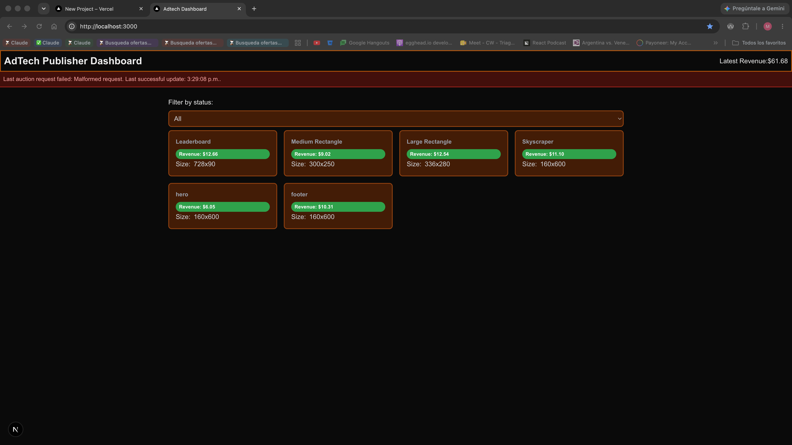

# AdTech Publisher Dashboard

A publisher-side dashboard that simulates header-bidding auctions for ad slots and shows their outcome and revenue in real time. Built as a practice project to apply modern Next.js, Tailwind and frontend system design on a domain I know from production AdTech work (Prebid.js, header bidding).

**Live demo:** 



## What it does

- Renders a responsive grid of ad slot cards from mock data.
- Runs a simulated auction per slot on the server, each with its own floor price and a 5-second timeout. Cards stream in as each auction finishes, behind a skeleton.
- Shows the result per slot (Winning, No Fill, Error).
- Shows a revenue total for the current round: the sum of the winning CPMs across all slots.
- Filters slots by status through the URL (`/?status=winning`). Invalid values fall back to "All". Changing the filter keeps the current UI visible while the new one renders, and the select updates immediately.
- Refreshes the dashboard every 5 seconds in the background. Cards already on screen stay visible while the new round loads.
- Typeahead search (limit of 10 results) backed by an `/api/search` route, with debounce, request cancellation, full keyboard navigation and ARIA combobox roles. It keeps its state while the server tree refreshes.
- Shows an error screen with a "Try again" button if the page fails to render. A failing card is isolated by its own error boundary, so the rest of the grid stays usable.
- Each card links to a slot detail page (`/slots/[slotId]`, the filter is kept in the link). It shows the slot's size and floor price, a "Current round" block that streams in behind a same-size skeleton, and a table with the last 10 rounds. Unknown ids return a real 404.
- Cards use container queries, so they adapt to their own width rather than the viewport.

## Stack

| Area | Choice |
| --- | --- |
| Framework | Next.js 16 (App Router), React 19 |
| Language | TypeScript |
| Styling | Tailwind CSS 4, class-variance-authority for component variants |
| Data | Mock ad slots and simulated auctions (no real ad server calls) |

## Project structure

```
app/          routes and API handlers (page.tsx is an async Server Component)
app/slots/    slot detail route: [slotId]/page.tsx (generateMetadata, notFound, history table)
components/   UI: slot cards, revenue total, status filter and typeahead (client islands), live refresh,
              error boundary, current round (detail) and its skeleton
hooks/        useTypeAhead, useDebounce (typeahead only)
lib/          auctions, history, seeded random, filter parsing, mock data
e2e/          Playwright tests (page objects and fixtures in fixture.ts)
e2e/unit/     specs for pure functions (seeded random, history); run in the same suite
```

## Design decisions

- **Server Components first.** The page, the slot cards and the revenue total are async Server Components. Only the pieces that need browser interaction are client components ("islands"): the status filter, the typeahead and `LiveRefresh`. `'use client'` goes in the first module the server imports, and everything that module imports becomes client code too.
- **One `<Suspense>` boundary per slot, and one for the revenue total.** One slow auction doesn't block the rest of the grid, and the header doesn't wait for the cards.
- **The filter lives in the URL.** The server reads `searchParams` (a Promise in this Next.js version) and validates it with `parseFilter`. The URL can be shared, reloaded and used with the back button. `StatusFilter` calls `router.replace` inside `useTransition`, and `useOptimistic` shows the selected value without waiting for the server.
- **Pure auction logic in `lib/auctions.ts`.** `resolveAuction` has no side effects and is easy to test. `runAuction` adds the simulated latency, and `getAuctionResult = cache(runAuction)` makes everything in one render share the same auction round per slot. The revenue total asks for every slot with `Promise.all` and gets the same promises the cards use, so it always matches what the cards show and doesn't run extra auctions.
- **Refresh without flicker.** `LiveRefresh` schedules the next `router.refresh()` only when the previous transition has finished, so refreshes can't pile up. React keeps the visible content during a transition, so cards don't go back to their skeleton.
- **Container queries** instead of viewport breakpoints so a slot card works the same in any layout.
- **The detail page reuses the auction logic.** `resolveAuction` takes its randomness through `AuctionDeps` (bid source, failure decision, id). The history passes a seeded generator (FNV-1a hash of slot and round into mulberry32), so the same slot always shows the same history. The order in which the generator is consumed is part of the contract, and a golden-value test pins it.
- **Streaming with no layout shift.** The "Current round" block is its own `<Suspense>` with a skeleton of the same size as the final block. A test measures both boxes, and CLS in the browser is 0. Static content (title, size, floor price) renders right away.
- **Errors are isolated per block.** A failing current round shows a fallback and the title, details and history stay. `notFound()` is thrown before streaming starts, so an unknown slot returns a real 404 status and not a 200 with a "not found" message.
- **Stretched link for the whole card.** Only the slot name is a link (`after:absolute after:inset-0` makes the whole card clickable), so screen readers hear one link per card. The focus ring is drawn on the card with `has-focus-visible`.
- **Tests use roles, not CSS.** E2E tests use role-based locators, a fixed-auctions mode (`E2E_FIXED_AUCTIONS=1`) and a failure hook (`?e2eFail=<slotId>`, only active in that mode). Each assertion was checked by breaking the code on purpose to see the test fail.

## Run it locally

```bash
npm install
npm run dev
```

Open http://localhost:3000.

## Run the tests

```bash
npm run type-check
npm run lint
npx playwright test
```

Playwright starts its own server in fixed-auctions mode on port 3100 (`reuseExistingServer` is off on purpose, so tests never run against a server in random mode). CI runs type-check, lint, build and the full suite on every push.

## Known limitations and next steps

- Data is mocked; no real Prebid.js or ad server integration (see my [prebid-playground](https://github.com/martinnajleprogrammer/prebid-playground) for that side).
- **The filter is applied on the server, after each auction.** Cards that don't match disappear, so the grid reflows instead of leaving empty cells.
- **Each filter change, reload or live refresh runs a new round of auctions.** `cache()` only lasts for a single render, so results aren't kept between requests. Results are random, which means the same slot can show a different outcome after changing the filter.
- **The slot detail view runs its own round, and its history is simulated.** Opening a slot is a new request, so its "Current round" can differ from the card you clicked (each request simulates a new round). The history table reuses `resolveAuction` with a seeded random generator per slot and round, so it is deterministic and testable but not real data. In production each auction would be appended to a per-slot store and the page would read the last N rows. E2E tests use the fixed-auctions mode, where card and detail match.
- **Revenue total is per round, not accumulated.** It sums the CPM of every winning slot, including those hidden by the filter, because the filter is a view and doesn't change the round. It assumes a single currency; the mock bidders only use one, so it doesn't convert or validate currencies.
- **Live refresh is polling, not push.** `LiveRefresh` calls `router.refresh()` inside a transition every 5 seconds (waiting for the previous refresh to finish), so visible cards stay on screen instead of going back to their skeleton. Each tick re-renders the whole route on the server, not only the widgets that changed. For real-time data in production I would poll just the widgets that change (SWR or React Query against a JSON endpoint) or use SSE.
- **No page-level banner for failed auctions.** A failed auction is just data: the card shows the Error status. Unexpected render exceptions are caught by `app/error.tsx` (with "Try again"). The old "last successful update" message was removed along with the client-side polling.
- The `/api/auctions` endpoint is kept for external calls, but the dashboard no longer uses it.
- **The error boundary on a card has no recovery test.** "Retry" re-fetches, but in the test the failure comes from the URL and fails again. It would need a transient failure.
- **Tests run on Chromium only.** No Firefox, WebKit or mobile viewports yet.
- Planned:
  - Performance pass on the production build (Lighthouse, CLS, INP) with the numbers in this README.
  - A simple accessible chart (SVG plus the existing table as its text equivalent) in the detail view.
  - A custom 404 page for the detail route, and a time of the last completed round in the header.
